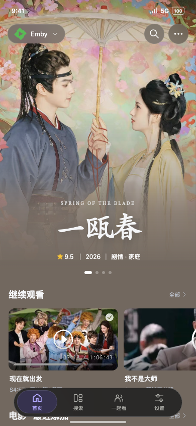
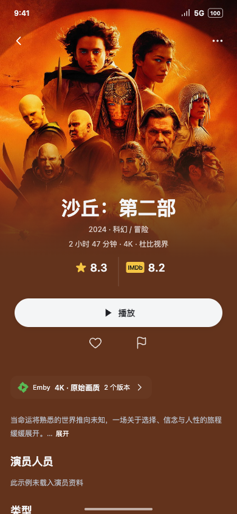

# 早期原型系列：最终 UI 基准 V1

这是用户指定的早期多页面原型，经过后续迭代形成最终 UI 基准 V1。其参考图、截图和交互已恢复，以保留当时的视觉效果；一张参考图仅遮盖敏感路径，尺寸及遮盖外像素不变。原型中的播放、房间、投屏和数据为演示。历史验证记录描述的是当时的工作，不代表当前产品通过了相同测试。

- [原型总览](prototype/index.html) · [首页](prototype/home.html) · [最终 UI 规范与截图](prototype/final-ui-spec.html)
- [UI 优化方案](prototype/ui-improvements.html) · [性能优化方案](prototype/performance-improvements.html)
- [详情](prototype/detail.html) · [媒体库](prototype/library.html) · [一起看](prototype/together.html) · [设置](prototype/settings.html) · [播放器](prototype/player.html)
- [最终 V1 脱敏 ZIP](downloads/prototype-final-v1-sanitized.zip)。脱敏包基于原冻结包重打包，仅替换敏感路径遮盖后的图片；本地原始文件未改动。

## 其他研究归档

- VidHub [研究报告](vidhub-study/report.html)、[报告文本](vidhub-study/report.md)。原始研究证据未公开；[整理后的研究摘要](../docs/research/README.md)另列。研究插画为替代示意，不能作为竞品截图证据。
- [历史品牌板](archive/brand/muchao-brand-board.html)、[项目文档](../docs/README.md)和[已被后续方向替代的三端融合历史方案](../docs/research/three-app-fusion-plan.md)。

[归档清单](ARTIFACT-MANIFEST.sha256)。在仓库或解压目录运行 `python3 -m http.server 8765`，访问 `/design/`，以便原型正常加载资源。仓库只保留这一版原型，V2、VidHub 研究原型与冻结副本已移除。原始参考图及历史截图用于展示历史设计，不表示拥有第三方作品的发行权。APK、原始逆向材料、凭据和私有服务器数据未纳入归档。
